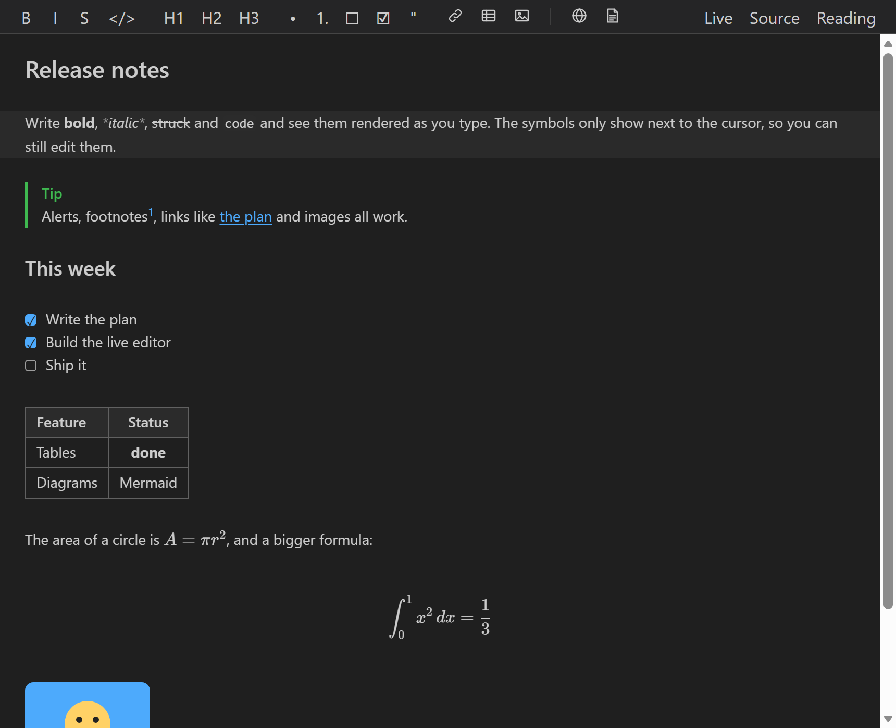
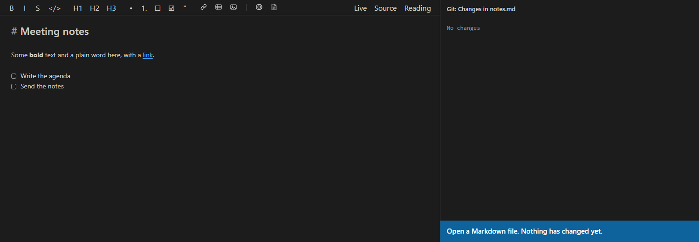
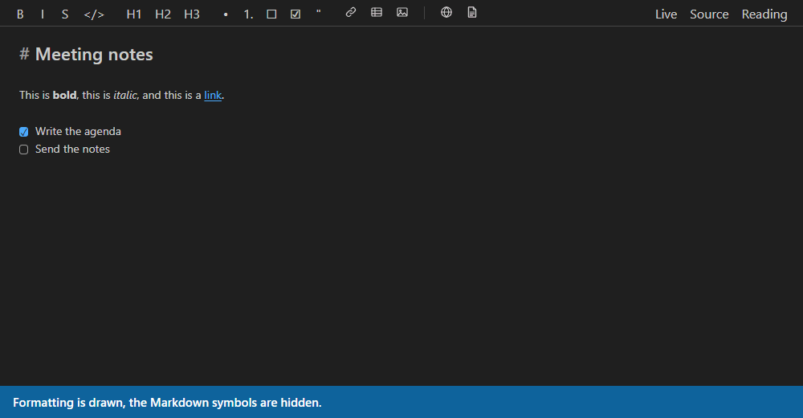
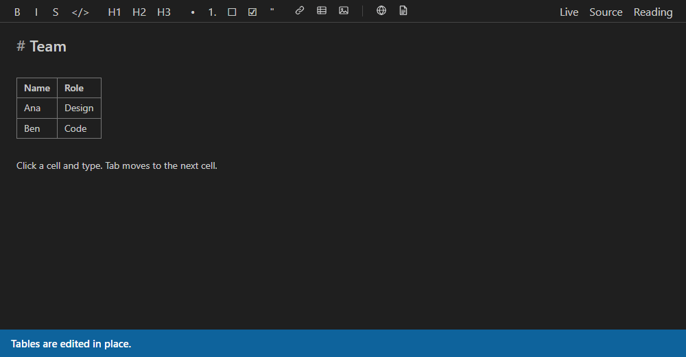
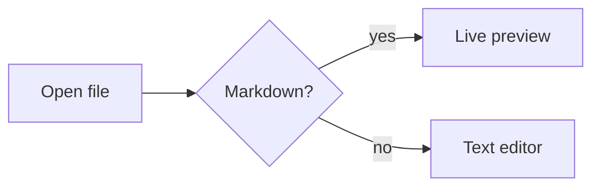
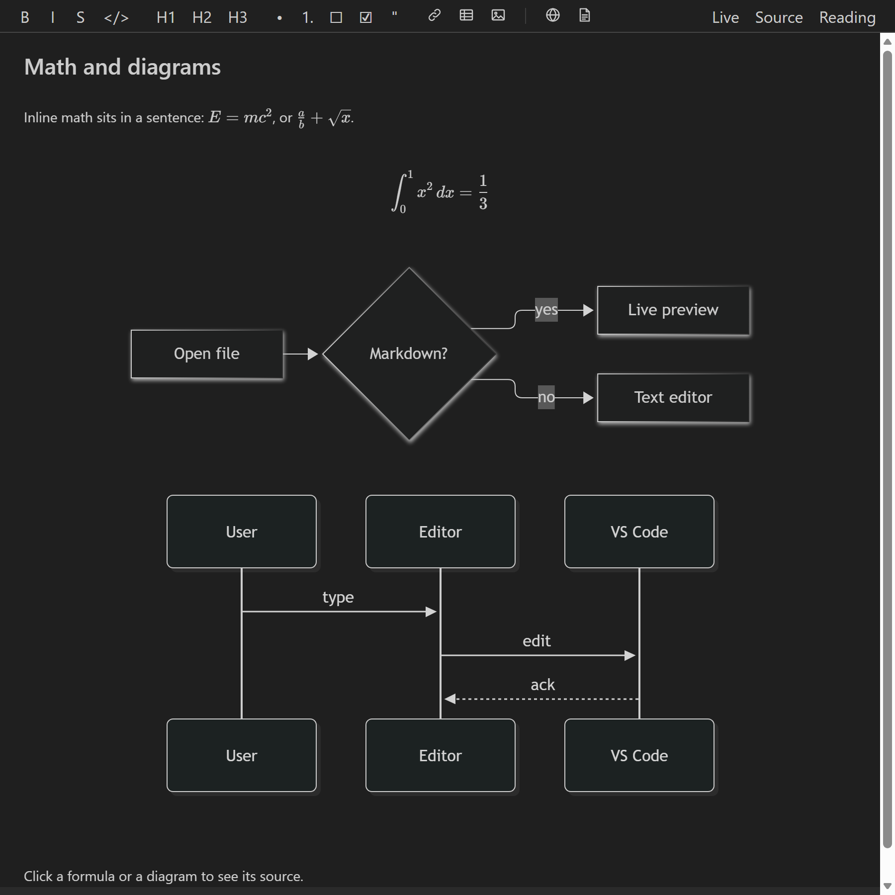

# Markdown Minimal Diff Editor

A live-preview Markdown editor for VS Code. Formatting is shown rendered as you type, and it **never rewrites parts of the file you didn't touch**.



## Change one word, and one word changes

Most WYSIWYG Markdown editors convert your file into their own document format and write it back out when you save. That can quietly reformat lists, swap `*` for `_` or re-space tables, so changing one word produces a large Git diff.

This extension edits the file's text directly and draws the rendered look over it. Make `bold` italic as well and this is the whole diff:

```diff
-Some **bold** text
+Some ***bold*** text
```

Here is a recording of the editor. The panel on the right is the diff built from the edits the editor sends to the file: making a word italic changes one line by two characters, and ticking a task changes one character.



Everything else in the file stays as it was, including your line endings (`\r\n` files stay `\r\n`). This is checked by tests on every command and widget action, and by a test that opens each sample file, types, undoes and saves, and compares the bytes.

## Features

- **Live mode:** headings are large, bold is bold, and links, images, tables, task checkboxes, math and diagrams appear in place. The Markdown symbols (`**`, `#`, `[text](url)`) show only around the cursor, so you can still edit them directly.
- **Source mode:** plain Markdown with syntax highlighting. It is also the best mode for screen readers.
- **Reading mode:** fully rendered and read-only.
- **GitHub-style Markdown:** tables, task lists, strikethrough, autolinks, alerts (`> [!NOTE]`), footnotes, front matter, math with KaTeX (`$x^2$` and `$$…$$`) and Mermaid diagrams.
- **Tables you can edit in place:** click a cell and type. Tab moves to the next cell. Only that cell's text changes in the file.
- **Task checkboxes:** a click toggles `[ ]` and `[x]`, a one-character edit.
- **Formatting toolbar and shortcuts**, list continuation on Enter, and pasted links.
- **Images:** paste or drop an image file (hold Shift while dropping) and it is saved to an `assets/` folder next to the document. Or use the Image button.
- **Go to Heading** and working `#anchor` links.
- **Export to HTML or PDF** from the toolbar or the Command Palette. Images and math are embedded, and Mermaid diagrams are drawn.
- Works with VS Code's own save, undo and redo, the unsaved-changes marker and Git, and in remote windows (checked in WSL).
- Follows your VS Code theme (light, dark and high contrast) and fonts. Raw HTML is shown as source unless you turn on rendering, and then it is sanitized.

## How editing works

You type in the document itself. There is no separate preview pane. Formatting is drawn over your text, and the Markdown symbols reappear where the cursor is, so you can edit them.

With the cursor on another line, the formatting is drawn and the symbols are hidden. Click into bold, italic or link text and its symbols appear. Move away and they hide again:



- **Format text:** select it and use the toolbar buttons or the shortcuts below.
- **Tasks:** click a checkbox to tick or untick it, or press `Ctrl/Cmd+Enter` on the line.
- **Tables:** click a cell and type. `Tab` moves to the next cell. Move the cursor into the table with the arrow keys to see its Markdown source.
- **Lists:** `Enter` continues a list, and `Enter` on an empty item ends it.
- **Pictures:** paste or drop an image, or use the Image button.
- **Change mode:** **Live**, **Source** and **Reading** are in the top right of the editor.

Editing a table: click a cell, type, and press `Tab` for the next cell.



## Math and diagrams

Write math between `$` signs, or between `$$` lines for a block. Draw a diagram in a fenced block marked `mermaid`:

````markdown
Inline math sits in a sentence: $E = mc^2$.

$$
\int_0^1 x^2 \, dx = \frac{1}{3}
$$


````

They are drawn in place, in the colours of your VS Code theme:



Click a formula or diagram to see and edit its source. A formula or diagram with a mistake shows the error and keeps your text.

## Using it

Open a `.md` file, right-click its tab, choose **Reopen Editor With…**, then **Markdown Minimal Diff Editor**. It never replaces VS Code's default editor unless you make it the default. You can also run **Markdown Minimal Diff Editor: Open in Markdown Minimal Diff Editor** from the Command Palette.

### Shortcuts

| Keys | Does |
|---|---|
| `Ctrl/Cmd+B`, `I`, `E` | Bold, italic, inline code |
| `Ctrl/Cmd+Alt+K` | Link |
| `Ctrl/Cmd+Shift+X` | Strikethrough |
| `Ctrl/Cmd+Alt+1` – `3` | Heading 1 – 3 |
| `Ctrl/Cmd+Shift+7`, `8`, `9` | Numbered list, bulleted list, quote |
| `Ctrl/Cmd+Enter` | Tick or untick the task on the line |
| `Ctrl/Cmd+Alt+M` | Switch to Source mode and back |
| `Ctrl/Cmd+Shift+O` | Go to Heading |

### Settings

| Setting | Does |
|---|---|
| `mdEditor.defaultMode` | The mode a file opens in: `live`, `source` or `reading` |
| `mdEditor.proseFontFamily` | A font for the text (VS Code's UI font by default) |
| `mdEditor.renderHtml` | Draw raw HTML blocks, sanitized, instead of showing their source |
| `mdEditor.customCss` | Your own CSS for the editor. User settings only. |
| `mdEditor.browserPath` | Chrome, Edge or Chromium for PDF export, if it is somewhere unusual. User settings only. |

### Export to PDF

PDF export uses Google Chrome or Microsoft Edge installed on the same machine as the extension. It looks in the usual places and shows an error if it finds neither. Nothing is bundled.

## Limits

- Math inside a table cell is shown as `$x$` text, not drawn.
- Mermaid diagrams are not redrawn when you switch VS Code's theme until the diagram is edited or the file reopened.
- The label of a code fence's language is hidden when the cursor is outside the block.
- IME input (Chinese, Japanese, Korean): each composition step is sent to the file as an edit, so undo has several steps.
- Very large files (over 10 MB) take a few seconds to be formatted at the far end after you jump there.
- Images next to a document on a virtual file system (such as a GitHub repository opened in the editor) cannot be shown.

## Development

Requires Node.js 22 or later.

```sh
npm install
npm run build              # bundle the extension and webview into dist/
npm run watch              # rebuild on change
npm test                   # unit tests (Vitest)
npm run test:integration   # integration tests in a downloaded copy of VS Code
npm run lint               # ESLint
npm run typecheck          # TypeScript
```

To try it, open this folder in VS Code and press **F5**. In the new window, open a `.md` file, right-click its tab, choose **Reopen Editor With…**, then **Markdown Minimal Diff Editor**.

| Folder | Contents |
|---|---|
| `src/` | Extension host: the custom editor provider, the host side of the sync, export |
| `webview/` | The editor inside the webview: CodeMirror setup, the live preview and the webview side of the sync |
| `test/unit/` | Unit tests, including randomized simulations of the sync and of the preview |
| `test/integration/` | Tests that run inside VS Code |
| `test/corpus/` | Sample Markdown files that every minimal-diff test runs on |

The design and roadmap are in [PLAN.md](PLAN.md). Manual checks before a release are in [TESTING.md](TESTING.md).

## Licence

[MIT](LICENSE)
