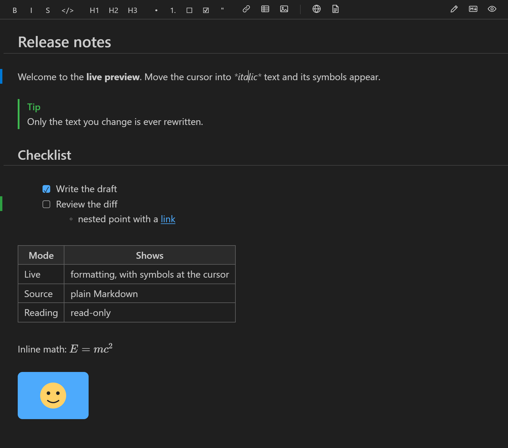
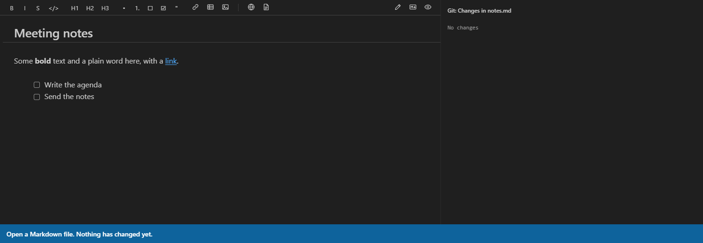
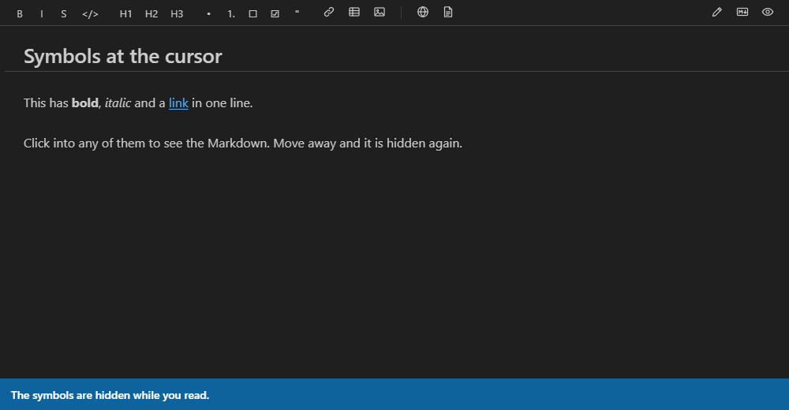
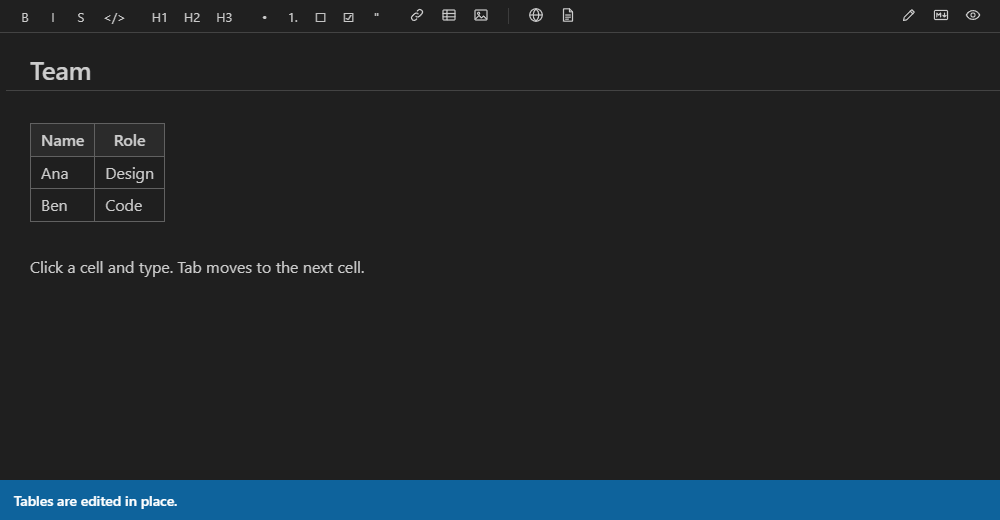
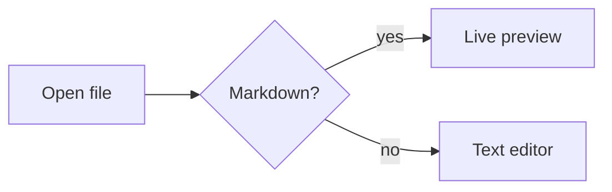
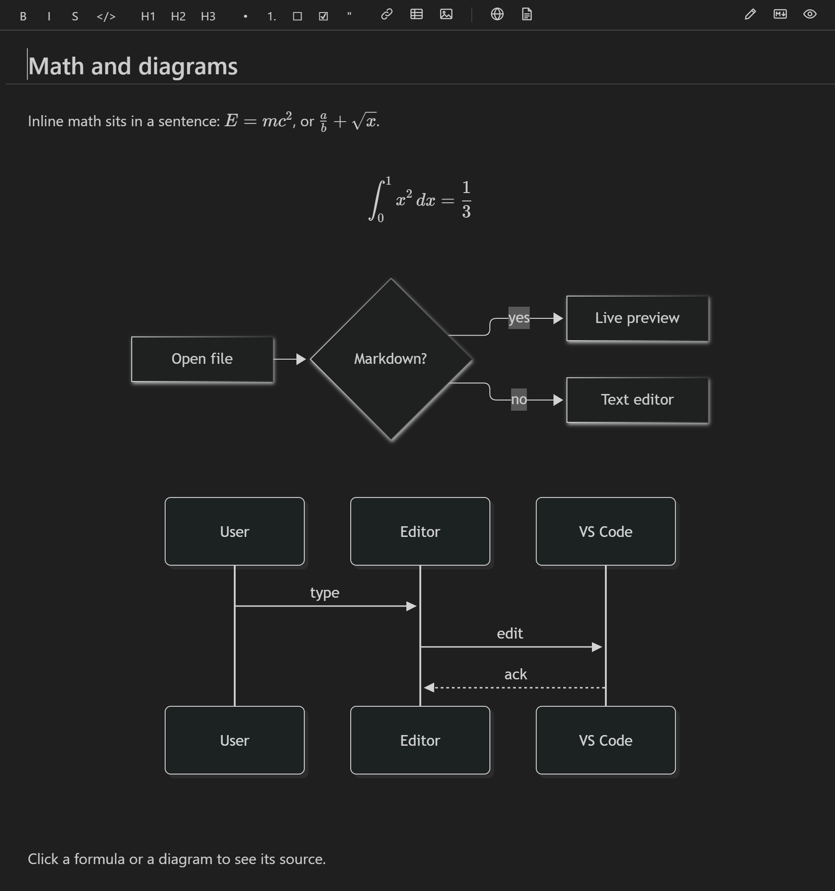

[English](README.md) | 简体中文 | [繁體中文](README.zh-TW.md)

# Markdown Minimal Diff Editor

一个用于 VS Code 的实时预览 Markdown 编辑器。输入时即显示渲染后的格式，并且**绝不改写文件中你没有动过的部分**。



## 改一个词，就只变一个词

大多数所见即所得的 Markdown 编辑器会把文件转换成自己的文档格式，保存时再写回去。这可能会悄悄地重新排版列表、把 `*` 换成 `_`、或重新调整表格的空格，于是只改一个词也会产生很大的 Git 差异。

这个扩展直接编辑文件的文本，并在文本上绘制渲染后的样子。把 `bold` 再设为斜体，整个差异只有这样：

```diff
-Some **bold** text
+Some ***bold*** text
```

下面是编辑器的录屏。右侧面板是根据编辑器发送给文件的编辑生成的差异：把一个词设为斜体，只在一行中改了两个字符；勾选一个任务，只改了一个字符。



文件中的其他内容都保持原样，包括换行符（`\r\n` 文件仍然是 `\r\n`）。每个命令和控件操作都有测试检查这一点；还有一个测试会打开每个示例文件、输入、撤销、保存，然后逐字节比较。

## 功能

- **实时模式**：标题显示为大字，粗体就是粗体，链接、图片、表格、任务复选框、公式和图表都直接显示在原处。Markdown 符号（`**`、`#`、`[text](url)`）只在光标附近显示，所以你仍然可以直接编辑它们。
- **源代码模式**：带语法高亮的纯 Markdown。也是最适合屏幕阅读器的模式。
- **阅读模式**：完全渲染，只读。
- **GitHub 风格的 Markdown**：表格、任务列表、删除线、自动链接、提示块（`> [!NOTE]`）、脚注、前置元数据（front matter）、KaTeX 公式（`$x^2$` 和 `$$…$$`）以及 Mermaid 图表。
- **可直接编辑的表格**：点击单元格即可输入。Tab 键移到下一个单元格。文件中只有该单元格的文本会改变。单元格文本中的 `☐`、`☑` 或 `☒` 会绘制为勾选框，每次点击切换到三种状态中的下一种（未完成、已完成、已划掉，然后回到未完成）。光标在单元格中（正在编辑它，或表格显示为源代码）时，工具栏的 `☐` 和 `☑` 按钮会输入它们，输入的 `[ ]` 或 `[x]` 在离开单元格时会变成 `☐` 或 `☑`。它们是普通字符，所有应用都能显示。
- **任务复选框**：点击即可在 `[ ]` 和 `[x]` 之间切换，只改一个字符。
- **Git 变更条**：受 Git 管理的文件会像 VS Code 自带的编辑器一样，在左侧用绿条标出新增的行，蓝条标出修改的行，红色小标记标出删除行的位置，对比的是文件已暂存的版本。变更条会随输入更新，并使用 VS Code 内置的 Git 扩展。
- **与 VS Code 的 Markdown 预览一致的外观**：列表的缩进相同（嵌套项目符号使用 `•`、`◦`、`▪`），一级和二级标题下方有一条细线。
- **格式工具栏和快捷键**，按 Enter 自动延续列表，粘贴链接。
- **图片**：粘贴或拖放图片文件（拖放时按住 Shift），图片会保存到文档旁边的 `assets/` 文件夹。也可以使用“图片”按钮。
- **转到标题**以及可用的 `#anchor` 链接。按住 Ctrl/Cmd 点击链接即可打开（表格单元格中的链接也可以），像 `other.md#usage` 这样的链接会在本编辑器中打开该文件并定位到标题。
- 从工具栏或命令面板**导出为 HTML 或 PDF**。图片和公式会嵌入，Mermaid 图表会被绘制出来。
- 支持 VS Code 自带的保存、撤销和重做、未保存标记和 Git，也支持远程窗口（已在 WSL 中检查）。
- 跟随你的 VS Code 主题（浅色、深色和高对比度）和字体。原始 HTML 默认显示为源代码，开启渲染后会先进行清理。
- 界面支持简体中文和繁体中文，跟随 VS Code 的显示语言。

## 编辑方式

你直接在文档中输入，没有单独的预览窗格。格式绘制在你的文本之上，光标所在之处会重新显示 Markdown 符号，方便你编辑。

光标在别的行时，格式会被绘制出来，符号会隐藏。点击粗体、斜体或链接文本，它的符号就会出现；移开后又会隐藏：



- **设置格式**：选中文本，然后使用工具栏按钮或下面的快捷键。
- **任务**：点击复选框勾选或取消勾选，或在该行按 `Ctrl/Cmd+Enter`。
- **表格**：点击单元格并输入。`Tab` 移到下一个单元格。用方向键把光标移进表格即可看到它的 Markdown 源代码。
- **列表**：`Enter` 延续列表，在空项目上按 `Enter` 结束列表。
- **图片**：粘贴或拖放图片，或使用“图片”按钮。
- **切换模式**：**实时**（铅笔）、**源代码**（Markdown 标志）和**阅读**（眼睛）是编辑器右上角的图标按钮。把鼠标停在按钮上可看到名称。

编辑表格：点击单元格，输入，然后按 `Tab` 到下一个单元格。



## 公式和图表

把公式写在 `$` 符号之间，或写在两行 `$$` 之间作为块。在标记为 `mermaid` 的围栏代码块中绘制图表：

````markdown
Inline math sits in a sentence: $E = mc^2$.

$$
\int_0^1 x^2 \, dx = \frac{1}{3}
$$


````

它们会以你的 VS Code 主题的颜色直接绘制在原处，在列表项中也可以：



点击公式或图表即可查看和编辑它的源代码。有错误的公式或图表会显示错误信息，并保留你的文本。

## 使用方法

打开一个 `.md` 文件，右键单击它的标签页，选择**重新打开编辑器的方式…**，然后选择 **Markdown Minimal Diff Editor**。除非你把它设为默认编辑器，否则它不会替换 VS Code 的默认编辑器。你也可以使用 Markdown 文件标题栏上的按钮，或在命令面板中运行 **Markdown Minimal Diff Editor: 在 Markdown Minimal Diff Editor 中打开**。

### 快捷键

| 按键 | 作用 |
|---|---|
| `Ctrl/Cmd+B`、`I`、`E` | 粗体、斜体、行内代码 |
| `Ctrl/Cmd+Alt+K` | 链接 |
| `Ctrl/Cmd+Shift+X` | 删除线 |
| `Ctrl/Cmd+Alt+1` – `3` | 标题 1 – 3 |
| `Ctrl/Cmd+Shift+7`、`8`、`9` | 有序列表、无序列表、引用 |
| `Ctrl/Cmd+Enter` | 勾选或取消勾选该行的任务 |
| `Ctrl/Cmd+Alt+M` | 切换到源代码模式并切回 |
| `Ctrl/Cmd+Shift+O` | 转到标题 |

### 设置

| 设置 | 作用 |
|---|---|
| `mdEditor.defaultMode` | 打开文件时使用的模式：`live`（实时）、`source`（源代码）或 `reading`（阅读） |
| `mdEditor.proseFontFamily` | 正文字体（默认使用 VS Code 的界面字体） |
| `mdEditor.renderHtml` | 绘制原始 HTML 块（会先清理），而不是显示其源代码 |
| `mdEditor.customCss` | 你自己的编辑器 CSS。只能在用户设置中设置。 |
| `mdEditor.browserPath` | 用于导出 PDF 的 Chrome、Edge 或 Chromium（如果它不在常见位置）。只能在用户设置中设置。 |

### 导出为 PDF

导出 PDF 使用与扩展安装在同一台机器上的 Google Chrome 或 Microsoft Edge。它会在常见位置查找，两者都找不到时会显示错误。扩展本身不附带浏览器。

## 限制

- VS Code 的大纲视图和面包屑导航在此编辑器中为空，因为 VS Code 只为文本编辑器填充它们。请改用**转到标题**（`Ctrl/Cmd+Shift+O`），或在文本编辑器中重新打开文件以查看大纲。
- 变更条要求文件位于磁盘上的 Git 仓库中，并且已启用内置的 Git 扩展。点击变更条不会打开差异视图。
- 表格单元格中的公式显示为 `$x$` 文本，不会被绘制。
- 引用块（`> `）中的公式、图表和表格显示为源代码。
- 切换 VS Code 主题后，Mermaid 图表不会重新绘制，直到你编辑该图表或重新打开文件。
- 光标在代码块外时，代码块的语言标签会隐藏。
- 输入法输入（中文、日文、韩文）：每个组字步骤都会作为一次编辑发送到文件，因此撤销会有多个步骤。
- 非常大的文件（超过 10 MB）在跳到文件末尾后，需要几秒钟才能完成格式绘制。
- 位于虚拟文件系统（例如在编辑器中打开的 GitHub 仓库）上的文档，其旁边的图片无法显示。

## 开发

需要 Node.js 22 或更高版本。

```sh
npm install
npm run build              # bundle the extension and webview into dist/
npm run watch              # rebuild on change
npm test                   # unit tests (Vitest)
npm run test:integration   # integration tests in a downloaded copy of VS Code
npm run lint               # ESLint
npm run typecheck          # TypeScript
```

要试用它，在 VS Code 中打开此文件夹并按 **F5**。在新窗口中打开一个 `.md` 文件，右键单击它的标签页，选择**重新打开编辑器的方式…**，然后选择 **Markdown Minimal Diff Editor**。

| 文件夹 | 内容 |
|---|---|
| `src/` | 扩展主机：自定义编辑器提供程序、同步的主机端、导出 |
| `webview/` | Webview 中的编辑器：CodeMirror 设置、实时预览以及同步的 webview 端 |
| `l10n/`、`package.nls.*.json` | 界面翻译 |
| `test/unit/` | 单元测试，包括同步和预览的随机模拟 |
| `test/integration/` | 在 VS Code 中运行的测试 |
| `test/corpus/` | 每个最小差异测试都会使用的示例 Markdown 文件 |

设计和路线图见 [PLAN.md](PLAN.md)（英文）。发布前的手动检查见 [TESTING.md](TESTING.md)（英文）。

## 许可证

[MIT](LICENSE)
