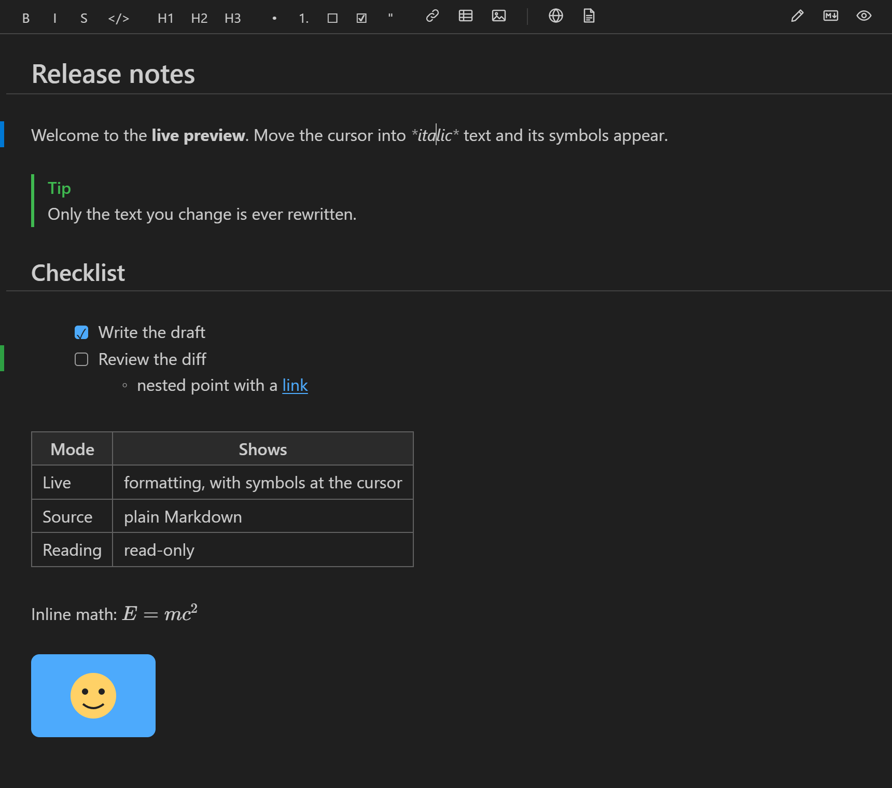
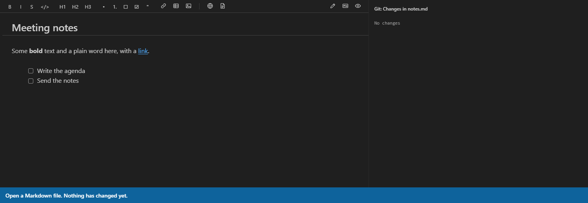
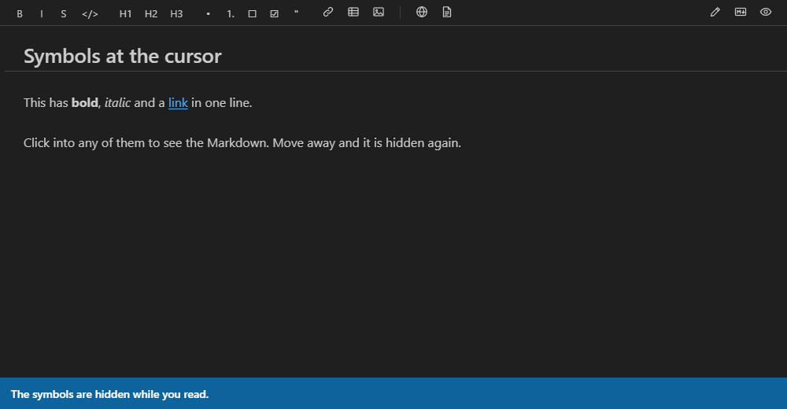
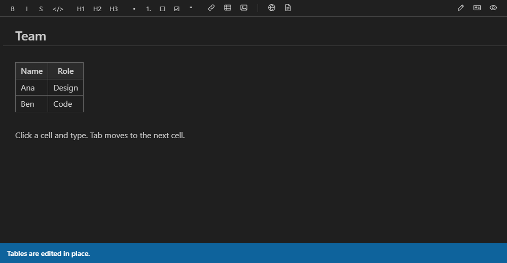
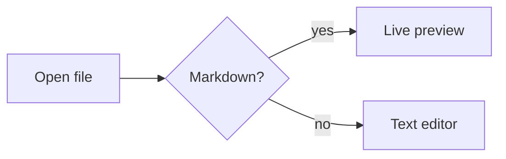
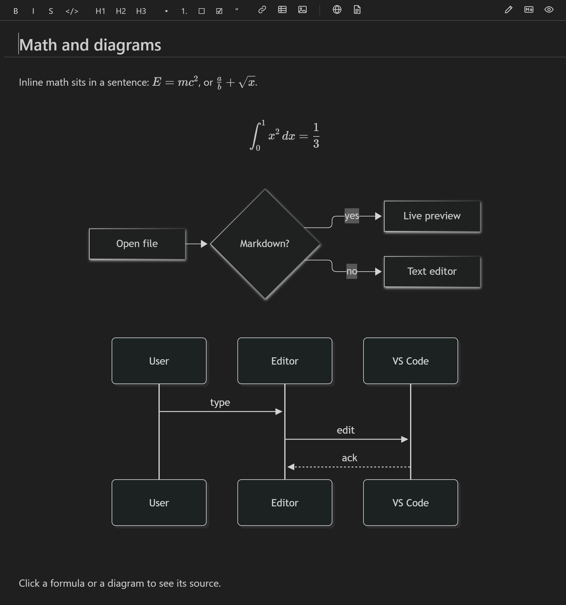

[English](README.md) | [简体中文](README.zh-CN.md) | 繁體中文

# Markdown Minimal Diff Editor

一個用於 VS Code 的即時預覽 Markdown 編輯器。輸入時即顯示轉譯後的格式，而且**絕不改寫檔案中你沒有動過的部分**。



## 改一個字，就只變一個字

大多數所見即所得的 Markdown 編輯器會把檔案轉換成自己的文件格式，儲存時再寫回去。這可能會悄悄地重新排版清單、把 `*` 換成 `_`、或重新調整表格的空白，於是只改一個字也會產生很大的 Git 差異。

這個擴充功能直接編輯檔案的文字，並在文字上繪製轉譯後的樣子。把 `bold` 再設為斜體，整個差異只有這樣：

```diff
-Some **bold** text
+Some ***bold*** text
```

下面是編輯器的錄影。右側面板是根據編輯器傳送給檔案的編輯所產生的差異：把一個字設為斜體，只在一行中改了兩個字元；勾選一個工作，只改了一個字元。



檔案中的其他內容都保持原樣，包括換行字元（`\r\n` 檔案仍然是 `\r\n`）。每個命令和控制項操作都有測試檢查這一點；另外還有一個測試會開啟每個範例檔案、輸入、復原、儲存，然後逐位元組比較。

## 功能

- **即時模式**：標題顯示為大字，粗體就是粗體，連結、圖片、表格、工作核取方塊、公式和圖表都直接顯示在原處。Markdown 符號（`**`、`#`、`[text](url)`）只在游標附近顯示，所以你仍然可以直接編輯它們。
- **原始碼模式**：有語法醒目提示的純 Markdown。也是最適合螢幕助讀程式的模式。
- **閱讀模式**：完全轉譯，唯讀。
- **GitHub 風格的 Markdown**：表格、工作清單、刪除線、自動連結、提示區塊（`> [!NOTE]`）、註腳、前置中繼資料（front matter）、KaTeX 公式（`$x^2$` 和 `$$…$$`）以及 Mermaid 圖表。
- **可直接編輯的表格**：按一下儲存格即可輸入。Tab 鍵移到下一個儲存格。檔案中只有該儲存格的文字會改變。儲存格文字中的 `☐` 或 `☑` 會繪製為核取方塊，按一下即可切換。游標在儲存格中（正在編輯它，或表格顯示為原始碼）時，工具列的 `☐` 和 `☑` 按鈕會輸入它們，輸入的 `[ ]` 或 `[x]` 在離開儲存格時會變成 `☐` 或 `☑`。它們是一般字元，所有應用程式都能顯示。
- **工作核取方塊**：按一下即可在 `[ ]` 和 `[x]` 之間切換，只改一個字元。
- **格式工具列和快速鍵**，按 Enter 自動延續清單，貼上連結。
- **圖片**：貼上或拖放圖片檔案（拖放時按住 Shift），圖片會儲存到文件旁邊的 `assets/` 資料夾。也可以使用「圖片」按鈕。
- **移至標題**以及可用的 `#anchor` 連結。
- 從工具列或命令選擇區**匯出為 HTML 或 PDF**。圖片和公式會內嵌，Mermaid 圖表會被繪製出來。
- 支援 VS Code 內建的儲存、復原和重做、未儲存標記和 Git，也支援遠端視窗（已在 WSL 中檢查）。
- 跟隨你的 VS Code 佈景主題（淺色、深色和高對比）和字型。原始 HTML 預設顯示為原始碼，開啟轉譯後會先進行清理。
- 介面支援繁體中文和簡體中文，跟隨 VS Code 的顯示語言。

## 編輯方式

你直接在文件中輸入，沒有另外的預覽窗格。格式繪製在你的文字之上，游標所在之處會重新顯示 Markdown 符號，方便你編輯。

游標在別的行時，格式會被繪製出來，符號會隱藏。按一下粗體、斜體或連結文字，它的符號就會出現；移開後又會隱藏：



- **設定格式**：選取文字，然後使用工具列按鈕或下面的快速鍵。
- **工作**：按一下核取方塊勾選或取消勾選，或在該行按 `Ctrl/Cmd+Enter`。
- **表格**：按一下儲存格並輸入。`Tab` 移到下一個儲存格。用方向鍵把游標移進表格即可看到它的 Markdown 原始碼。
- **清單**：`Enter` 延續清單，在空白項目上按 `Enter` 結束清單。
- **圖片**：貼上或拖放圖片，或使用「圖片」按鈕。
- **切換模式**：**即時**、**原始碼**和**閱讀**位於編輯器右上角。

編輯表格：按一下儲存格，輸入，然後按 `Tab` 到下一個儲存格。



## 公式和圖表

把公式寫在 `$` 符號之間，或寫在兩行 `$$` 之間作為區塊。在標記為 `mermaid` 的圍欄程式碼區塊中繪製圖表：

````markdown
Inline math sits in a sentence: $E = mc^2$.

$$
\int_0^1 x^2 \, dx = \frac{1}{3}
$$


````

它們會以你的 VS Code 佈景主題的色彩直接繪製在原處，在清單項目中也可以：



按一下公式或圖表即可檢視和編輯它的原始碼。有錯誤的公式或圖表會顯示錯誤訊息，並保留你的文字。

## 使用方式

開啟一個 `.md` 檔案，以滑鼠右鍵按一下它的索引標籤，選擇**以下列方式重新開啟編輯器…**，然後選擇 **Markdown Minimal Diff Editor**。除非你把它設為預設編輯器，否則它不會取代 VS Code 的預設編輯器。你也可以在命令選擇區中執行 **Markdown Minimal Diff Editor: 在 Markdown Minimal Diff Editor 中開啟**。

### 快速鍵

| 按鍵 | 作用 |
|---|---|
| `Ctrl/Cmd+B`、`I`、`E` | 粗體、斜體、行內程式碼 |
| `Ctrl/Cmd+Alt+K` | 連結 |
| `Ctrl/Cmd+Shift+X` | 刪除線 |
| `Ctrl/Cmd+Alt+1` – `3` | 標題 1 – 3 |
| `Ctrl/Cmd+Shift+7`、`8`、`9` | 編號清單、項目符號清單、引用 |
| `Ctrl/Cmd+Enter` | 勾選或取消勾選該行的工作 |
| `Ctrl/Cmd+Alt+M` | 切換到原始碼模式並切回 |
| `Ctrl/Cmd+Shift+O` | 移至標題 |

### 設定

| 設定 | 作用 |
|---|---|
| `mdEditor.defaultMode` | 開啟檔案時使用的模式：`live`（即時）、`source`（原始碼）或 `reading`（閱讀） |
| `mdEditor.proseFontFamily` | 文字的字型（預設使用 VS Code 的介面字型） |
| `mdEditor.renderHtml` | 繪製原始 HTML 區塊（會先清理），而不是顯示其原始碼 |
| `mdEditor.customCss` | 你自己的編輯器 CSS。只能在使用者設定中設定。 |
| `mdEditor.browserPath` | 用於匯出 PDF 的 Chrome、Edge 或 Chromium（如果它不在常見位置）。只能在使用者設定中設定。 |

### 匯出為 PDF

匯出 PDF 使用與擴充功能安裝在同一台電腦上的 Google Chrome 或 Microsoft Edge。它會在常見位置尋找，兩者都找不到時會顯示錯誤。擴充功能本身不附帶瀏覽器。

## 限制

- VS Code 的大綱檢視和階層連結在此編輯器中是空的，因為 VS Code 只為文字編輯器填入它們。請改用**移至標題**（`Ctrl/Cmd+Shift+O`），或在文字編輯器中重新開啟檔案以查看大綱。
- 表格儲存格中的公式顯示為 `$x$` 文字，不會被繪製。
- 引用區塊（`> `）中的公式、圖表和表格顯示為原始碼。
- 切換 VS Code 佈景主題後，Mermaid 圖表不會重新繪製，直到你編輯該圖表或重新開啟檔案。
- 游標在程式碼區塊外時，程式碼區塊的語言標籤會隱藏。
- 輸入法輸入（中文、日文、韓文）：每個組字步驟都會作為一次編輯傳送到檔案，因此復原會有多個步驟。
- 非常大的檔案（超過 10 MB）在跳到檔案結尾後，需要幾秒鐘才能完成格式繪製。
- 位於虛擬檔案系統（例如在編輯器中開啟的 GitHub 存放庫）上的文件，其旁邊的圖片無法顯示。

## 開發

需要 Node.js 22 或更新版本。

```sh
npm install
npm run build              # bundle the extension and webview into dist/
npm run watch              # rebuild on change
npm test                   # unit tests (Vitest)
npm run test:integration   # integration tests in a downloaded copy of VS Code
npm run lint               # ESLint
npm run typecheck          # TypeScript
```

要試用它，在 VS Code 中開啟此資料夾並按 **F5**。在新視窗中開啟一個 `.md` 檔案，以滑鼠右鍵按一下它的索引標籤，選擇**以下列方式重新開啟編輯器…**，然後選擇 **Markdown Minimal Diff Editor**。

| 資料夾 | 內容 |
|---|---|
| `src/` | 擴充功能主機：自訂編輯器提供者、同步的主機端、匯出 |
| `webview/` | Webview 中的編輯器：CodeMirror 設定、即時預覽以及同步的 webview 端 |
| `l10n/`、`package.nls.*.json` | 介面翻譯 |
| `test/unit/` | 單元測試，包括同步和預覽的隨機模擬 |
| `test/integration/` | 在 VS Code 中執行的測試 |
| `test/corpus/` | 每個最小差異測試都會使用的範例 Markdown 檔案 |

設計和路線圖請見 [PLAN.md](PLAN.md)（英文）。發佈前的手動檢查請見 [TESTING.md](TESTING.md)（英文）。

## 授權

[MIT](LICENSE)
