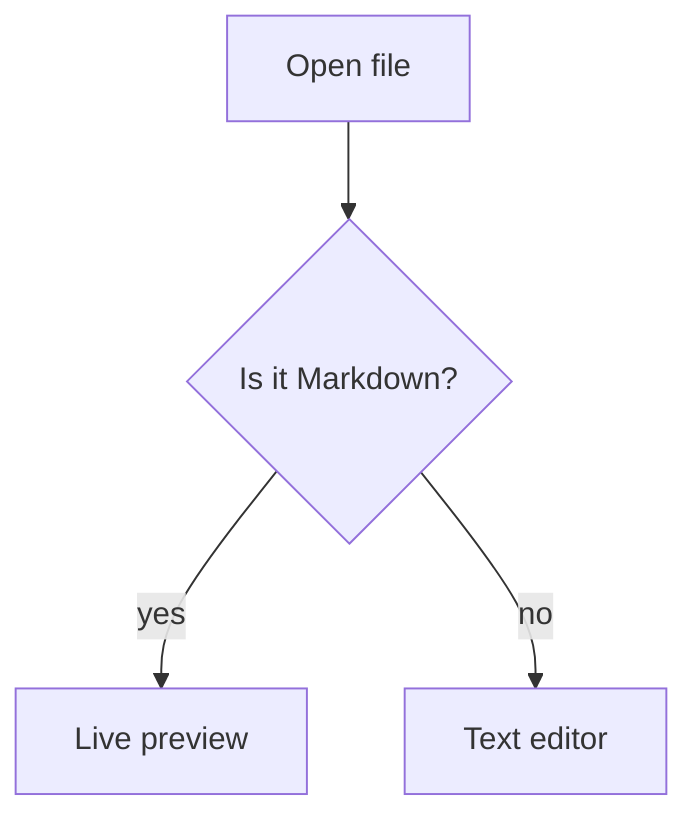
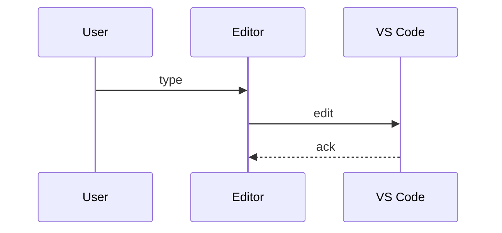

# Math and diagrams

Inline math sits in a sentence: $E = mc^2$, or $\frac{a}{b} + \sqrt{x}$. Prices like $5 and $6 stay plain text.

A block formula with `$$`:

$$
\int_0^1 x^2 \, dx = \frac{1}{3}
$$

The same idea in a math fence, which GitHub also supports:

```math
\sum_{k=1}^{n} k = \frac{n(n+1)}{2}
```

A formula with a mistake shows KaTeX's error instead of breaking the page: $\frac{1}{$

## Mermaid





A diagram with a syntax error shows a message and keeps the source:

```mermaid
graph TD
  A --> 
```

The end.
